# CMS Hospital Insights on Microsoft Fabric

> **For demonstration purposes only.** This project shows how public hospital data can be turned into an interactive
> dashboard and hosted on Microsoft Fabric. It is not medical, clinical or financial advice. Every number it shows depends
> entirely on the public data sources it downloads (CMS, CDC via CMS, U.S. Census Bureau, OpenStreetMap and others), on
> when they were downloaded, and on how this code processes them. Those sources can be revised, delayed or incomplete.
> Check anything important against the original source. In a medical emergency, call 911.

> **Set it up with an AI coding agent.** This repository is complex: a data build from several public sources,
> optional Microsoft Fabric lakehouses, semantic models and a Fabric App, and an optional GitHub Copilot chat that runs
> on your computer or as an Azure Container App. Setting it up manually is not recommended. Point your agent (GitHub
> Copilot, Claude Code, Codex or similar) at this repository and ask it to follow **[AGENTS.md](AGENTS.md)**. It asks
> whether you want the chat as well, explains what that involves in Azure and GitHub Copilot, then runs and checks
> each step.

A web dashboard of U.S. hospital quality and access to maternity care, in four tabs:

- **Overview**: what the dashboard covers, where each dataset comes from, and what the chat can answer.
- **Quality & safety**: nine sections on healthcare-associated infections, benchmarking, a state map that drills down to a street map of every hospital, maternity care access (drive time to the nearest hospital that delivers babies or has a NICU, with an address search, road routes and directions), patient experience, PSI‑90 patient safety, how these relate, outcomes and Medicare penalties, and a hospital explorer.
- **Insights and takeaways**: thirteen written findings with their trends. The text was written from an earlier build of the same data, so its figures can differ slightly from a newer build.
- **Ask your data** (optional): a GitHub Copilot chat that answers questions about the data with DAX queries on two Fabric semantic models and figures drawn like the dashboard's. Right-click any chart, map or finding to ask about it in **Quick chat**, a panel docked beside the dashboard.

It is plain HTML, CSS and JavaScript (D3, MapLibre and Vega, included in `assets/vendor/`) with Python scripts that build the data and a Python server for the chat. **The repository contains no data**: the scripts download it from public sources and build it locally. Optionally, the tables can be loaded into Microsoft Fabric (lakehouses and Direct Lake semantic models) and the dashboard hosted as a Fabric App.

## What you need

### For the dashboard

- Python 3.10 or later (numpy, Pillow and SciPy from `requirements.txt`), an internet connection and about 3 GB of free disk space. The first build downloads under 1 GB and takes roughly 10–30 minutes. No accounts.
- Optional, to publish the data or host the dashboard on Microsoft Fabric: a Fabric workspace on a running capacity (F SKU or trial) where you are Member or Admin, the Azure CLI (`az login`), and Node.js 20, 22 or 24 for the Fabric App.

### For Ask your data (optional)

On your computer:

- A GitHub account with a **GitHub Copilot** plan. Each question uses that plan's requests. Sign in with the GitHub Copilot CLI (`copilot login`) or the GitHub CLI (`gh auth login`), or paste a token into the page.
- The **CMS** and **CMS V2** semantic models in a Fabric workspace (`publish_fabric.py` creates them), on a capacity that is running while you chat, and `az login` with access to that workspace. The chat answers with DAX queries on these models.
- Python 3.11 or later.

In the Fabric-hosted app, in addition:

- The dashboard deployed as a Fabric App.
- An **Azure subscription** where you can create a resource group, a Container Apps environment, a container registry (Basic tier, a small monthly charge) and a Container App that runs the chat relay. The relay scales to zero when nobody is asking.
- A **GitHub OAuth App** that you register on github.com, and its client secret, which you store in Azure yourself.
- Every viewer signs in with GitHub and uses their own Copilot plan.
- The app gains Rayfin Functions, a Rayfin Data database for saved chats and a lakehouse for saved answers.

## Screenshots

These were taken from a build of the public data; your build will show the data as of when you run it. Hospital names, phone numbers and the GitHub account are blurred here, and appear normally in the app.

### Summary

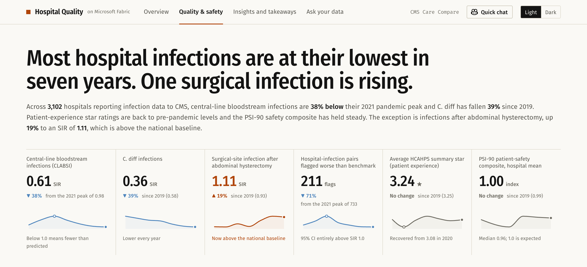

### Infection trends, with the story beside them

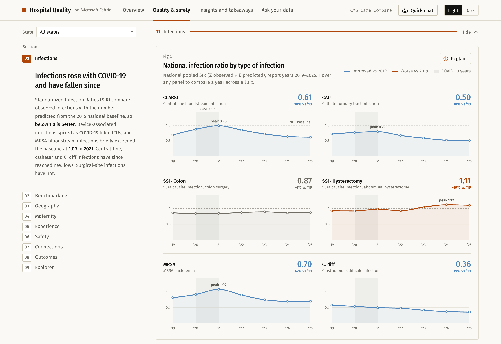

### PSI‑90 by state, and every hospital in a state

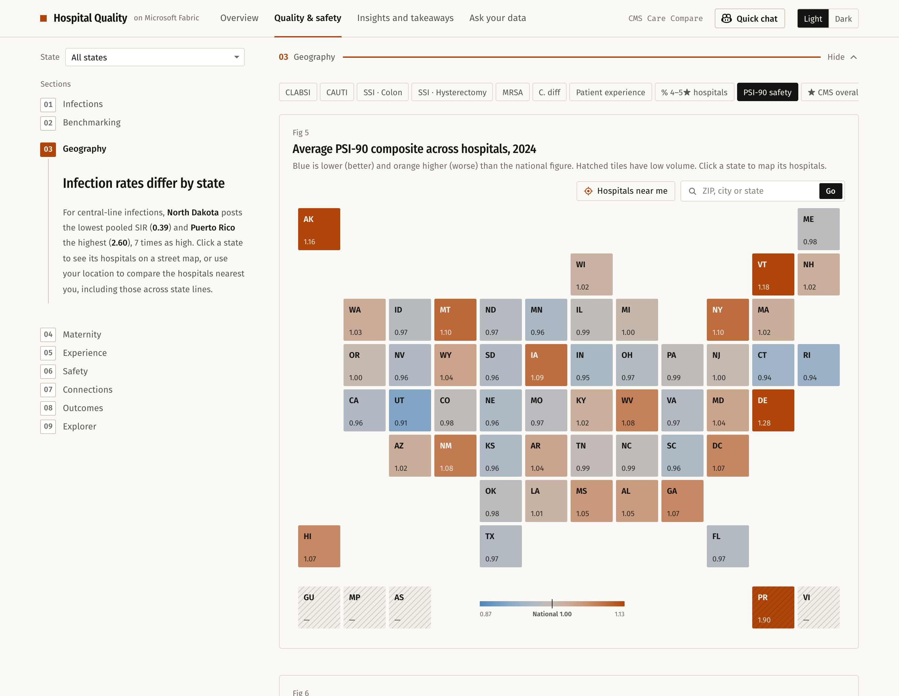

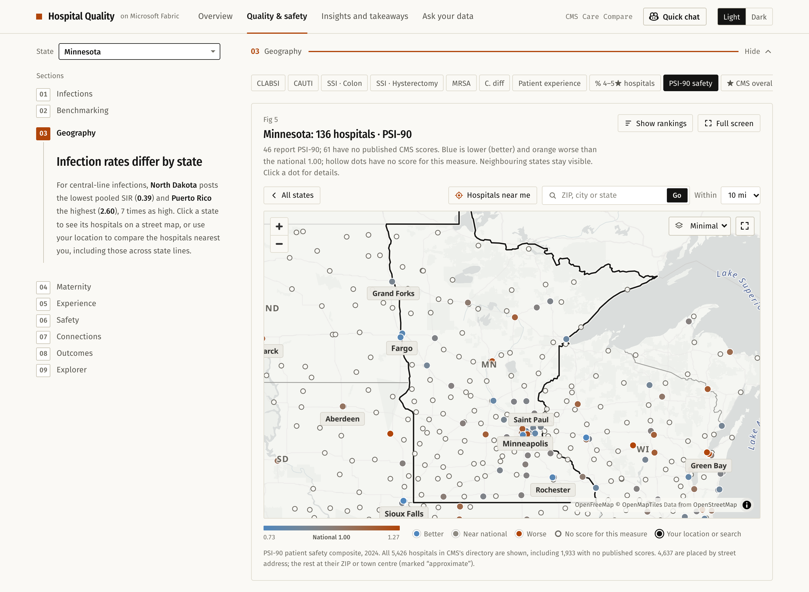

### Maternity care: how far is the nearest hospital that delivers babies, or the nearest NICU?

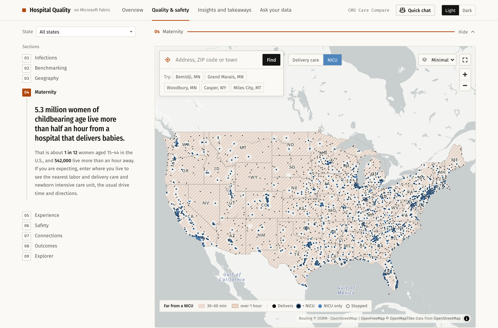

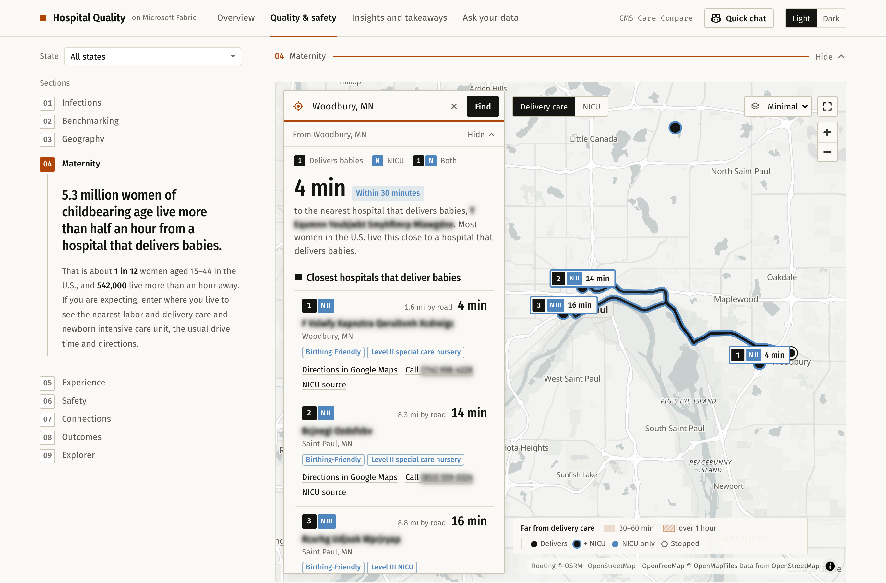

### Insights and data sources

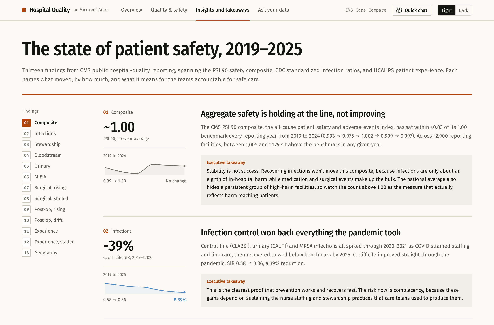

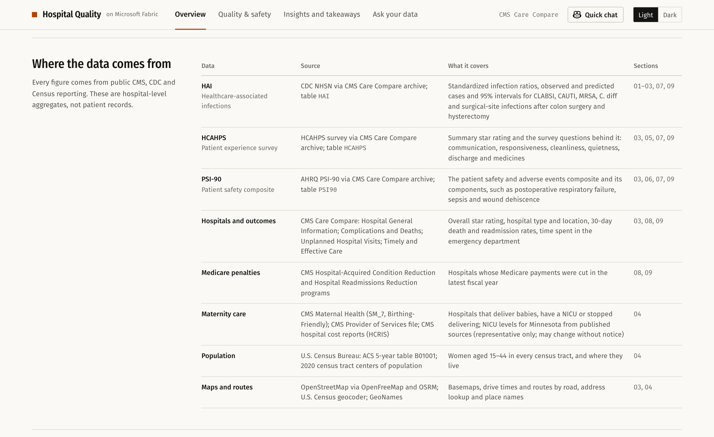

### Ask your data

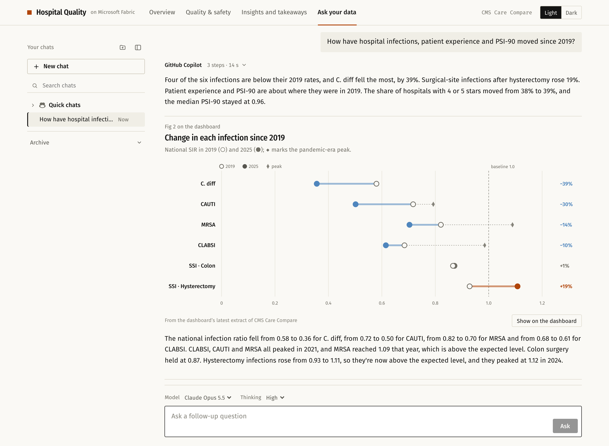

### Quick chat beside a map

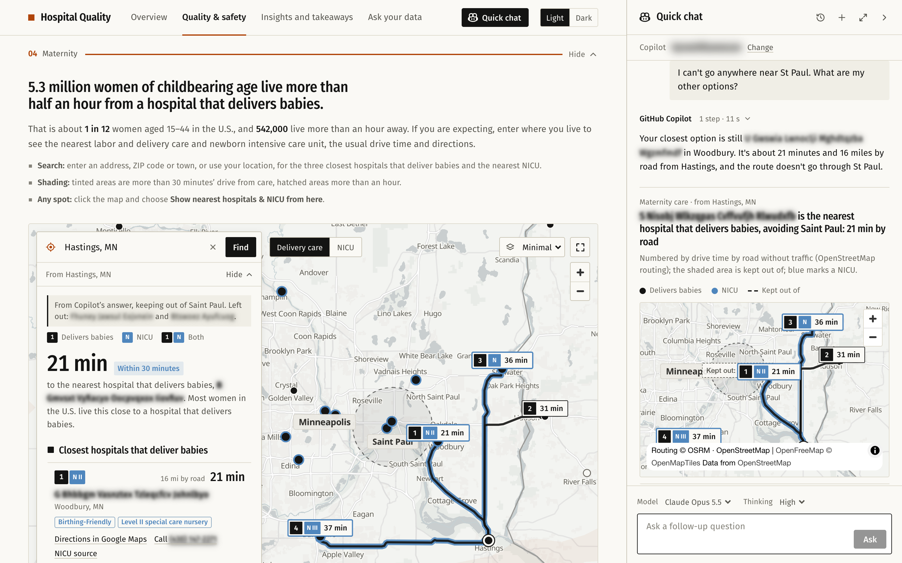

### Saved chats

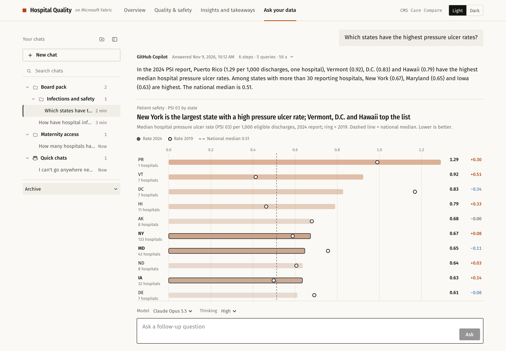

## Ask your data

The tab holds a conversation with GitHub Copilot. Its header shows the title, the GitHub account Copilot runs as and nine roles (executive, nursing, public health and others), each with its own suggested questions; the box stays at the bottom with the model and thinking level above it. Under each answer's byline, its steps open to show how Copilot answered: its reasoning, each DAX query, each figure it chose with its settings, and what came back. Each figure is measured as drawn (size, label size and overlap, colours that are hard to tell apart) and Copilot redraws any the check flags. Where one of the dashboard's charts fits, it is redrawn in the answer, with **Show on the dashboard** to open the original with the same settings; otherwise Copilot picks one of 33 figure templates, then Vega-Lite, then custom D3.

Questions about places and trips ("we're driving from Denver to Moab and my wife is 35 weeks pregnant") use `copilot/geo.py`: places from the dashboard's own GeoNames, ZIP and hospital address files, and roads and drive times from OpenStreetMap (OSRM). "Nearest" and "from here" questions draw a street map like the dashboard's maternity and hospital maps, with pins numbered by drive time and the road route to each, and can keep out of a town or a state or leave out hospitals ("I can't get into St Paul"). **Show on the map** puts the same search on the dashboard's map.

Right-click a hospital on a chart, a state, a KPI or a finding, and an **Ask Copilot** popup opens next to the pointer with questions that fit what you pointed at. Pick one or start typing and the popup becomes Quick chat, a panel docked on the right with the page narrowing beside it. Drag its edge to resize it, hide it, and bring it back with **Quick chat** in the top bar; maximize opens the same chat in the Ask your data tab, where right-clicking a figure in an answer asks a follow-up in that chat. Every question carries what you have open: a search on the maternity or hospital map (its start point, the hospitals listed with drive times, the card open), the explorer's filters, the chip or hospital picked on a figure. So "from here" and "these hospitals" mean what is on screen, and the suggested questions are about it. When an answer redraws a map for a question that came from that map, the map beside Quick chat shows the new search too.

Every chat is saved with its answers, in folders that can sit inside other folders. Drag a chat or a folder to move it, or use its menu to rename, move, archive or delete it. Chats started in Quick chat go to the **Quick chats** folder. A reopened chat shows its answers as they were, and the next question continues the same Copilot session. On your computer the history is kept in `data/chats/` (git-ignored); in the Fabric app it is kept in Fabric, each viewer's own.

The chat appears only where a chat server is reachable: at http://127.0.0.1:8765 when `copilot/server.py` runs, and in the Fabric App once the relay is set up. Opened any other way, the dashboard works on its own without the tab. [copilot/TESTING.md](copilot/TESTING.md) describes the tests and the 81-question evaluation; [copilot/QUESTIONS.md](copilot/QUESTIONS.md) lists the questions each role asks.

## Quick start (local)

Your agent does all of this from [AGENTS.md](AGENTS.md). For reference, the dashboard alone:

```sh
pip install -r requirements.txt
python3 build_all.py                 # downloads the public data and builds every file the dashboard loads
python3 -m http.server 8000          # then open http://localhost:8000/
```

With Ask your data, once the **CMS** and **CMS V2** models are in Fabric (`publish_fabric.py`, below):

```sh
python3 -m venv .venv && .venv/bin/pip install -r requirements.txt -r copilot/requirements.txt
export CMS_WORKSPACE_ID=<workspace-id>          # the Fabric workspace with the two models
.venv/bin/python copilot/server.py              # then open http://127.0.0.1:8765/#ask
```

## Optional: Microsoft Fabric

- **Data in Fabric.** `publish_fabric.py --workspace <id>` loads the tables into two lakehouses and creates two Direct Lake semantic models: **CMS** (infections, HCAHPS, PSI‑90) and **CMS V2** (outcomes, penalties, maternity). Ask your data queries them. `refresh_data.py` can also build the dashboard's core data by querying the **CMS** model with DAX instead of reading the local files; both routes give identical numbers.
- **App hosted on Fabric.** `fabric-app/` packages the dashboard and deploys it as a Fabric App with the Rayfin CLI. Viewers sign in with their Fabric account.
- **Ask your data in the Fabric App.** `copilot/deploy.py` creates the Azure resources for the chat relay (an Azure Container App running `copilot/server.py`), builds and deploys it, and adds the app's Rayfin Functions and saved-chat storage. Each viewer signs in to GitHub from the app. You register the GitHub OAuth App and store its secret yourself.

All of these need a Fabric workspace on a running capacity and the Azure CLI (`az login`); see [AGENTS.md](AGENTS.md#5-optional-publish-to-microsoft-fabric).

## Layout

| Path | What it is |
| --- | --- |
| `index.html`, `assets/styles.css`, `assets/js/` | The dashboard |
| `assets/fonts.css`, `assets/vendor/` | Fira fonts (embedded), D3, MapLibre and Vega |
| `build_*.py`, `refresh_data.py`, `download_inputs.py`, `geocode_hospitals.py`, `verify_against_cms.py`, `cms_archive.py` | The data build (`build_all.py` runs them in order) |
| `publish_fabric.py` | Lakehouses and semantic models in Fabric |
| `data/nicu_levels.csv` | Curated NICU levels with a source URL for each |
| `fabric-app/` | The Rayfin project that builds and deploys the dashboard to Fabric, with the Rayfin Functions `chatTicket`, `dax` and `chatPayload` and the Rayfin Data tables for saved chats (`rayfin/data/`) |
| `copilot/` | The Copilot server for Ask your data (`server.py`, its tools, model instructions and DAX runners, places and routes in `geo.py`, the local chat history in `history.py`), its relay image and `deploy.py`; tests in `copilot/dev/` |
| `assets/js/chat/`, `assets/chat.css` | The Ask your data tab, Quick chat, saved chats and the answer renderer |
| `assets/figures/` | The figure templates answers are drawn with, themed like the dashboard |
| `docs/screenshots/` | The screenshots in this README |

## How the data is built

| Step | Script | Source | Output |
| --- | --- | --- | --- |
| Place names, state outlines | `build_places.py` | GeoNames, us-atlas (Census) | `assets/places.js`, `assets/state-shapes.js`, `assets/vendor/vega/us-states-10m.json` |
| Infections, HCAHPS, PSI‑90 tables | `build_core_tables.py` | CMS hospitals archive (one snapshot per table and report year, pinned in `cms_archive.py`) | `data/core/*.csv` |
| Core chart data | `refresh_data.py --local` (or from a semantic model) | `data/core/*.csv` | `assets/data.js` |
| Hospital locations | `geocode_hospitals.py` | CMS hospital directory, U.S. Census geocoder and ZIP centroids | `assets/hospital-locations.js`, `assets/zip-centroids.js` |
| Outcomes, ED times, penalties | `build_quality_extra.py` | CMS Care Compare | `assets/quality-extra.js`, `data/fabric/` |
| Maternity inputs | `download_inputs.py` | CMS Maternal Health, Provider of Services, cost reports; Census ACS and tract centres | `data/raw/` |
| Maternity care access | `build_maternity.py` | the above, plus `data/nicu_levels.csv` | `assets/maternity.js`, `assets/maternity-access.js`, `data/fabric/` |
| Independent check of Fig 1 | `verify_against_cms.py` | CMS hospitals archive | `assets/verification.js` |

`build_all.py` runs them in this order.

## About the NICU levels

`data/nicu_levels.csv` lists newborn intensive care (NICU) levels gathered by hand from public pages (mainly in Minnesota), with a source link on every row. **It is included for representation only. The information may be out of date and may change at any time without notice.** Validate and update it before relying on it, and confirm a hospital's level of newborn care with the hospital itself. Hospitals not in the file still show whether they have a NICU (from CMS files), just without a level.

## Limitations

- CMS publishes each measure for a different period, and revises past periods; see `cms_archive.py` for the exact snapshots used.
- Drive times on the national map are estimates from straight-line distance; routes in the address search come from the public OSRM demo server and ignore traffic.
- The hospital map places most hospitals by street address (U.S. Census geocoder) and the rest at their ZIP code's centre.
- The public map tile, routing and geocoding services have usage limits; for heavy use, run your own or use a paid provider.
- Ask your data's answers are written by an AI model from DAX queries it chooses. Its steps show each query and what came back; check important numbers against the dashboard or the source.

## Licence

MIT for this repository's code (see [LICENSE](LICENSE)). Bundled libraries, fonts and the downloaded data keep their own terms: see [THIRD_PARTY_NOTICES.md](THIRD_PARTY_NOTICES.md).
